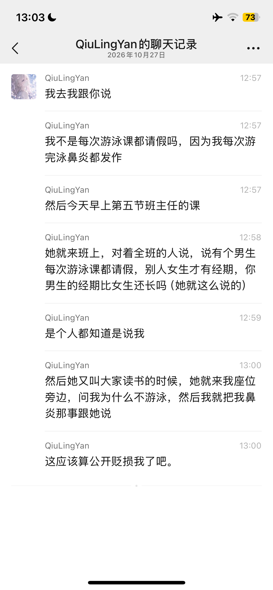
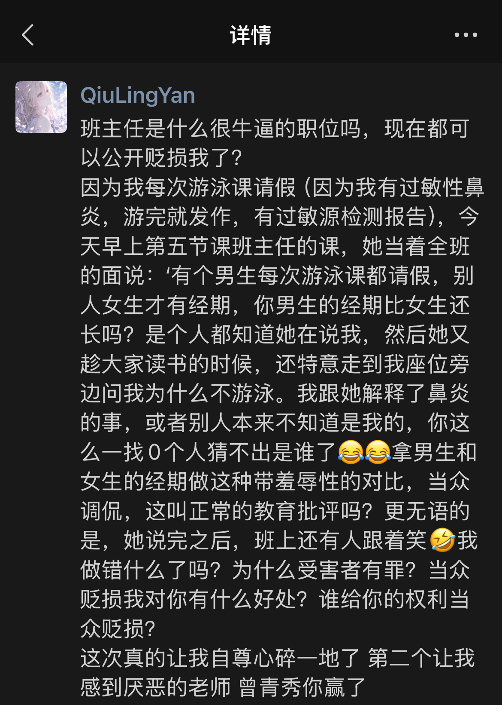

bg：由于本人过敏性鼻炎十分的严重（这个学期我总共上了两节游泳课，但是两节课游完泳的当天下午我都出现了急性鼻炎，很难受），于是我选择从第三次开始就请假。

附：本人在事件发生当天的聊天记录和朋友圈。

虽然过敏不一定是因为泳池的水，但是由于泳池水低温导致鼻子的血管收缩、引起急性鼻炎的可能性很大（而且我本身有鼻炎）。

bg：我们学校的游泳课师生比是1:54且不设救生员。

事件：2026.10.27上午≈11:10～11:15，第五节课是班主任的游泳课。班主任曾青秀来到班上以后，对着全班的人说了以下内容（仅为转录，不能保证百分百还原当时的话语，但是我敢保证还原度很高，特别是那句具有羞辱性的话语）：

> 游泳课要认真上，不要老是请假，有个人从开学到现在一直都请游泳课的假，而且还是个男生，别人女生才说有经期，你一个男生的经期比女生还长吗？你一个男生有什么好……（后面的忘了，大体意思是说一个男生有什么好害羞的），男生就应该坦荡一点，外面的游泳课一期都要一千多块，学校现在免费教你你都不去上。

（不保证百分百还原！但是从“别人女生”一直到“比女生还长”这里我敢保证这绝对是曾青秀说的话，如果我说的是假的我愿意承担法律责任。）

然后她就开始上课，但是上课前先让我们读了书（读的是选必一全优课堂p78-83）。在读书期间，她走过来我的座位，问我为什么每次都请假。我回答是因为有特殊情况，她没等我说完又打断我说有什么特殊情况。我说因为我鼻炎很严重，每次游完泳的下午鼻炎都发作，导致我下午很难受，所以才选择请假。曾青秀跟我说那就是免疫力低下（注意到过敏性鼻炎似乎跟免疫力没有什么关系）。曾青秀在没有私下询问过我具体原因就在班上公开地贬损我，这点不是教育方式的问题，这就是师德师风的问题。

我请了这么多次假，班上的人自然知道曾青秀说的是我；其次就算不知道，她直接来我座位上找我谈话，自然不知道的也就知道了。当时在曾青秀说完“男生的经期比女生还长”这句话的时候，班上出现了明显对我的一种嘲笑的行为（或者是氛围），这个是曾青秀的不当言语直接导致的结果。

就算我每次请假需要批评我，请问曾青秀有没有私底下询问过我的身体状况？亦或是询问过我家长我的身体状况？为什么受害者有罪？

在如今的社会环境下，如果我选择向12345或者是德育股投诉，必然曾青秀会联系我的家长。所以我只能先保留不投诉。但是这种严重伤害学生自尊心的行为我是不会放过她的。拿性别刻板、羞辱学生来批评学生的，我认为也不是什么好老师了。

附：本人在事件发生当天的聊天记录和朋友圈。

